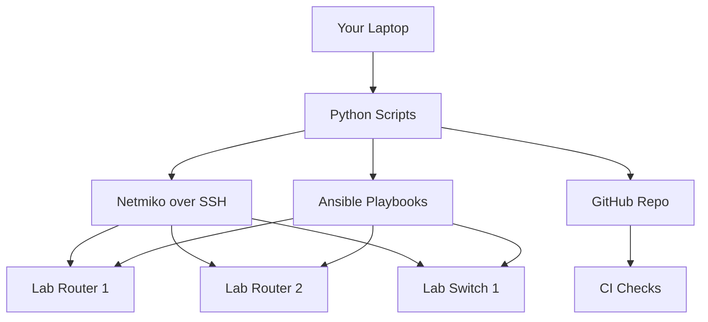

# Network Automation with Python

Status - Lab template to be completed. This repo is a hands-on lab plan for learning network automation. It is not production experience and it is not a completed project. Work through the labs against GNS3 lab devices, take your own screenshots, and update the status line of each lab as you finish it.

## Objective

Stop typing the same commands into every device by hand. Learn Python basics, then use Netmiko to log in to lab routers and switches, back up configs, push changes, and check results. Then learn Ansible, REST APIs, JSON and YAML, Docker basics, and CI/CD basics. The goal is to automate the boring parts of network work safely, with a check before every change.

## Architecture



## Technologies used

- Python fundamentals
- Netmiko
- Bash scripting
- Git and GitHub
- Ansible
- REST APIs, JSON, and YAML
- Terraform fundamentals
- Docker fundamentals
- CI/CD fundamentals
- GNS3 lab devices as the test target

## Lab topology

- GNS3 lab with two routers and one switch, the same topology as the enterprise networking labs
- Router 1 on 192.168.10.1, router 2 on 192.168.10.2, switch 1 on 192.168.10.3
- SSH turned on for all three devices
- Your laptop on the same lab network, with Python 3 and Netmiko installed

## Configuration examples

Install Netmiko.

```
pip install netmiko
```

Back up the running config of one device. Save this as backup_one.py.

```python
from netmiko import ConnectHandler

device = {
    "device_type": "cisco_ios",
    "host": "192.168.10.1",
    "username": "admin",
    "password": "lab-password",
}

connection = ConnectHandler(**device)
output = connection.send_command("show running-config")
with open("r1-backup.txt", "w") as backup_file:
    backup_file.write(output)
connection.disconnect()
print("Backup done")
```

Run it.

```
python3 backup_one.py
```

Back up three devices from one script. Save this as backup_all.py.

```python
from netmiko import ConnectHandler

devices = [
    {"device_type": "cisco_ios", "host": "192.168.10.1", "username": "admin", "password": "lab-password"},
    {"device_type": "cisco_ios", "host": "192.168.10.2", "username": "admin", "password": "lab-password"},
    {"device_type": "cisco_ios", "host": "192.168.10.3", "username": "admin", "password": "lab-password"},
]

for device in devices:
    connection = ConnectHandler(**device)
    output = connection.send_command("show running-config")
    filename = device["host"] + "-backup.txt"
    with open(filename, "w") as backup_file:
        backup_file.write(output)
    connection.disconnect()
    print("Backed up " + device["host"])
```

Push a config change from a file. Save this as push_config.py.

```python
from netmiko import ConnectHandler

device = {
    "device_type": "cisco_ios",
    "host": "192.168.10.1",
    "username": "admin",
    "password": "lab-password",
}

connection = ConnectHandler(**device)
output = connection.send_config_from_file("change.txt")
print(output)
connection.save_config()
connection.disconnect()
print("Change pushed")
```

Check a device is reachable before you touch it. Save this as ping_check.py.

```python
import subprocess

hosts = ["192.168.10.1", "192.168.10.2", "192.168.10.3"]

for host in hosts:
    result = subprocess.run(["ping", "-c", "2", host], capture_output=True, text=True)
    if result.returncode == 0:
        print(host + " is up")
    else:
        print(host + " is down")
```

Read a device with a REST API call. This example uses the requests library against a lab controller.

```python
import requests

url = "https://192.168.10.100/restconf/data/ietf-interfaces:interfaces"
headers = {"Accept": "application/yang-data+json"}
response = requests.get(url, headers=headers, auth=("admin", "lab-password"), verify=False)
print(response.status_code)
print(response.json())
```

Parse JSON output in Python.

```python
import json

with open("device.json") as json_file:
    data = json.load(json_file)

for interface in data["interfaces"]:
    print(interface["name"] + " is " + interface["status"])
```

## Ansible lab

Install Ansible.

```
pip install ansible
```

Write an inventory file called hosts.ini.

```ini
[lab_routers]
r1 ansible_host=192.168.10.1
r2 ansible_host=192.168.10.2

[lab_switches]
sw1 ansible_host=192.168.10.3

[lab:children]
lab_routers
lab_switches
```

Write a playbook that backs up every device. Save it as backup.yml.

```yaml
---
- name: Back up lab device configs
  hosts: lab
  gather_facts: false
  tasks:
    - name: Get running config
      cisco.ios.ios_command:
        commands:
          - show running-config
      register: config_output
    - name: Save config to a file
      copy:
        content: "{{ config_output.stdout[0] }}"
        dest: "./backups/{{ inventory_hostname }}-backup.txt"
```

Run the playbook in check mode first, then for real.

```
ansible-playbook backup.yml --check
ansible-playbook backup.yml
```

## Docker lab

Run a small container to test Docker basics.

```
docker run hello-world
docker ps
docker images
```

Build a container that runs the backup script on a schedule. Save this as Dockerfile.

```dockerfile
FROM python:3.12-slim
WORKDIR /app
COPY requirements.txt .
RUN pip install -r requirements.txt
COPY backup_all.py .
CMD ["python3", "backup_all.py"]
```

Build and run it.

```
docker build -t lab-backup .
docker run lab-backup
```

## CI/CD lab

A GitHub Actions workflow that checks every Python file compiles. Save it as .github/workflows/check.yml.

```yaml
---
name: Check Python files
on:
  push:
    branches:
      - main
jobs:
  check:
    runs-on: ubuntu-latest
    steps:
      - name: Check out the code
        uses: actions/checkout@v4
      - name: Set up Python
        uses: actions/setup-python@v5
        with:
          python-version: "3.12"
      - name: Compile every Python file
        run: python3 -m compileall .
```

## Implementation steps

1. Install Python 3 and Netmiko on your laptop
2. Build the GNS3 lab and turn on SSH for every device
3. Run the ping check script and confirm all three devices answer
4. Run the single device backup script and read the backup file
5. Run the three device backup script and check all three files exist
6. Write a small change file, push it with the push script, and confirm the change on the device
7. Write the Ansible inventory and playbook, run it in check mode, then for real
8. Run the REST API example against a lab controller
9. Build the Docker image and run the backup inside a container
10. Push the repo to GitHub and watch the CI workflow run

## Verification commands

```
python3 -m py_compile backup_one.py
python3 -m py_compile backup_all.py
python3 -m py_compile push_config.py
python3 -m py_compile ping_check.py
ansible-playbook backup.yml --check
ansible-playbook backup.yml --syntax-check
docker build -t lab-backup .
```

## Troubleshooting scenarios

- Netmiko cannot connect, so check SSH is on, the address is right, and you can ping the device first
- The script runs but the backup file is empty, so check the command output and confirm the login worked
- Ansible says the host is unreachable, so check the inventory file and test SSH by hand
- The playbook fails on one device, so run it with one host at a time to find which one breaks
- Docker build fails, so check the Dockerfile spelling and confirm the files it copies exist
- The CI workflow fails, so read the workflow log and fix the named file

## Security best practices

- Never put a real password in a script, use environment variables or a vault instead
- Test every script against lab devices first, never against a live network
- Run in check mode before you push a change
- Back up the config before you push anything
- Keep credentials out of Git, and check with git status before every commit
- Use SSH keys where you can instead of passwords

## Learning outcomes

- Write Python scripts that log in to network devices with Netmiko
- Back up configs from many devices with one script
- Push a config change from a file and confirm it worked
- Read and write JSON and YAML
- Write an Ansible playbook and run it in check mode
- Call a REST API from Python
- Run a script inside a Docker container
- Set up a CI workflow that checks your code on every push

## Screenshot placeholders

- screenshots/backup-script.png - Placeholder, add a screenshot of the backup script running
- screenshots/ansible-run.png - Placeholder, add a screenshot of the Ansible playbook output
- screenshots/ci-workflow.png - Placeholder, add a screenshot of the CI workflow passing

## Project status

Lab template to be completed. No lab in this repo is finished yet. Update this section as each lab is done.
